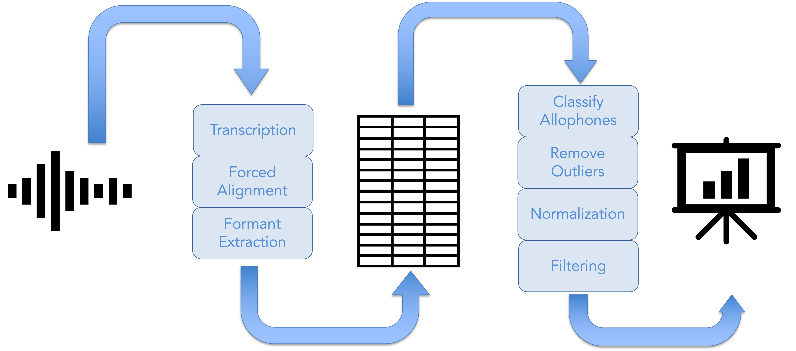
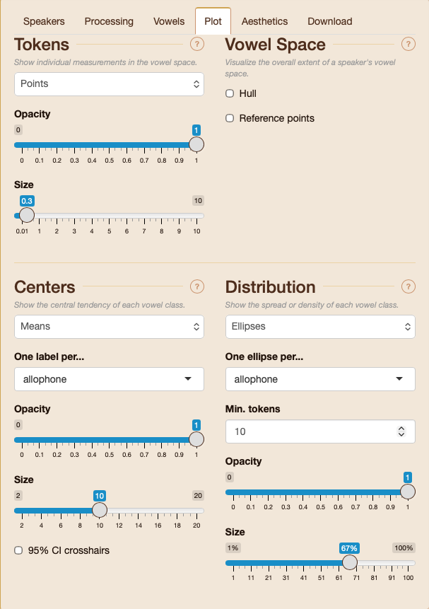
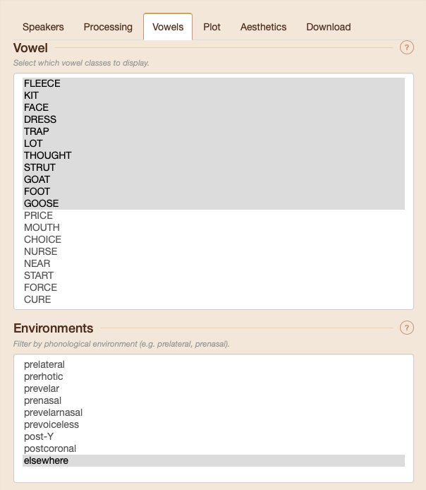
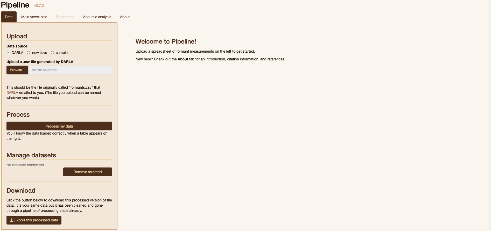
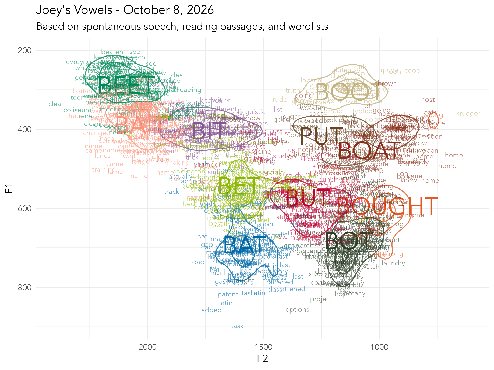
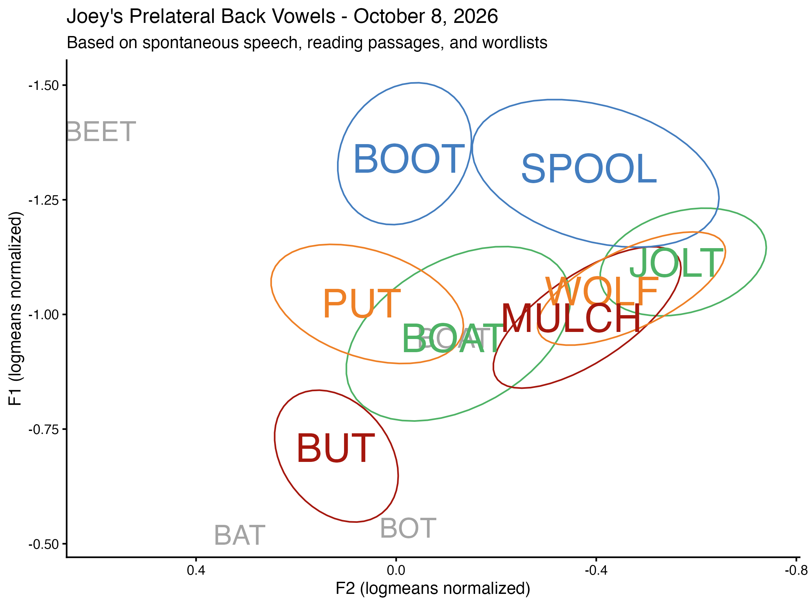
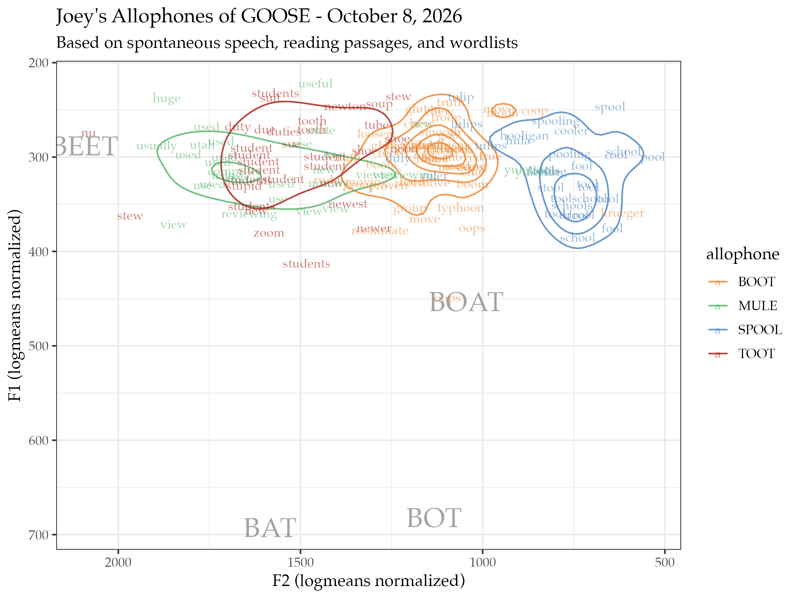
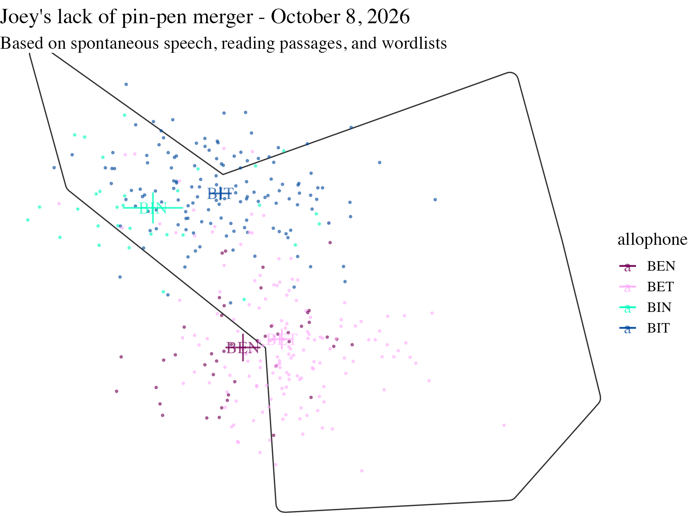
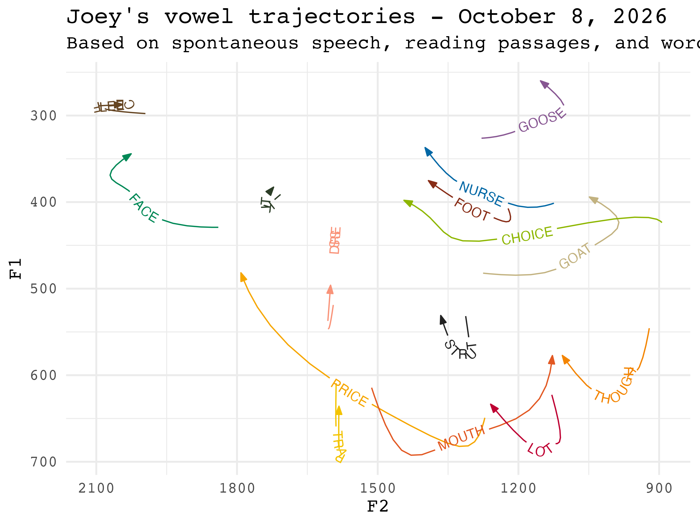
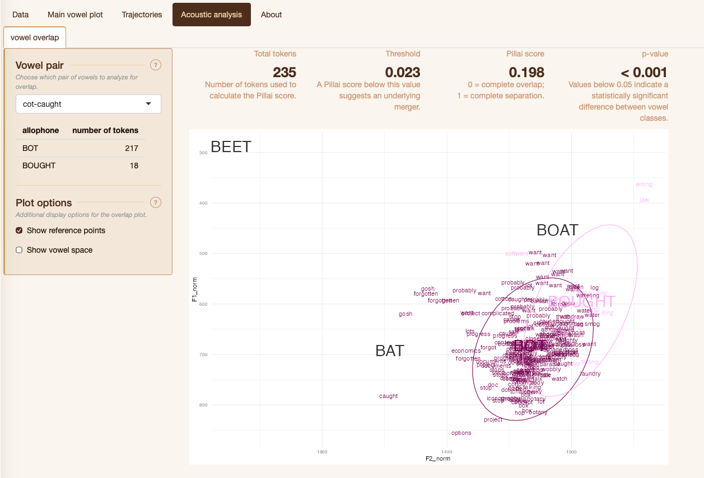

I'm at [NWAV 54](https://nwav54.org) in Montreal and I'm excited to announce a new tool I've been working on this year called [Pipeline](https://stanley.byu.edu/pipeline/)! This is a tool that takes vowel formant data and creates an interactive vowel plot. The goal for the software is to lower the barrier to entry into sociophonetic data analysis so that curious students can jump straight to the "fun" part and see vowel data without having to learn to code first.

## Data Processing

There is a whole pipeline of sociophonetic data processing steps to go from raw audio to a spreadsheet of formant measurements to then a spreadsheet of cleaned data ready for visualization and analysis. This figure from my presentation shows that:

Software like the now-defunct [DARLA](/blog/darla) or my own [VoxHumana](/voxhumana-teaser) handles the first half of that assembly line. Pipeline handles the second half. Specifically it does the following, in this order (Details about these methods, including citations, can be found in the app itself on the About tab.)

* It classifies phonemes into allophones based on surrounding consonants.
* It removes outliers using Mahalanobis distances.
* It normalizes the vowels, if applicable. 
* It removes stopwords and unstressed vowels. 

All these can be done with data generated by FAVE-Extract (which what DARLA used) or new-fave (which is what VoxHumana uses). 

## Data Visualization

From there, you can interact with your data with a customizable, responsive vowel plot. You can adjust what vowels are shown, what allophones of those vowels, how they’re shown, toggle between normalization procedures, and adjust the aesthetics of the plot itself.

With each plot, you can adjust the following:

* The raw data as points, words, or nothing, as well as their transparency and size.
* Central points for each phoneme or allophone as means, medians, or nothing, optionally with 95% crosshairs, as well as their transparency and size.
* Distributions, whether as ellipses, KDE contours, or nothing, their transparency and size. 
* The overall vowel space as a convex hull or reference points.

The UI for these options is seen in the following screenshot:

You can decide which vowels to show and in what phonological environments. This is done using [joeyr::code_allophones()](https://joeystanley.github.io/joeyr/reference/code_allophones.html), which you can explore for details on which allophones are coded for which phonemes and how they're determined.

For every plot, you can adjust the title, subtitle, and axes, font size and font family, overall theme, and the display size. 

You can also download any of the figures in a variety of formats and sizes.

IF you're working with trajectories, the options are limited for now, but you can view them as as smoothed or raw.

Here are some plots I made of my own vowels using Pipeline.

Here's the full vowel space.

Here are my back prelateral vowels.

Here are my allophones of <sc>goose</sc>.

Here is my lack of the <sc>pin-pen</sc> merger.

And here are my vowel trajectories.

## Data Analysis

Pipeline can also do some analysis on a few mergers. Here are my <sc>lot</sc> and <sc>thought</sc> vowels showing that they're phonetically close but not identical. 

Here's the same thing for my /ʊl/ and /ol/ classes, which are very close. 

## Other Notes

I will say that Claude has helped with the creation of Pipeline. Much of the code is written by me (and is borrowed from my Gazetteer of Southern Vowels from grad school!). But as I've expanded the program, added features, added robustness, and added security, it has required more time than I have to code it myself. So, Claude has been used to help with this code. However, AI is not used in the app itself, which means your data never interacts with AI. 

All processing happens on a server in the Office of Digital Humanities at Brigham Young University. Each instance of the app is siloed off from the others, which means no one has access to your data, including me, and the data is deleted from the server when your session is done. 

There are a lot of things that I'd like to add to Pipeline. Support for languages other than English is a big one, but I'm not familiar with the data processing that needs to happen for those, so I'd need some help from others. Switching between transcription systems is one I've heard people ask for, but it turns out that is such a huge rabbit hole and I'm not quite ready to tackle it yet. I'd like to add ways to customize and refine the processing that happens under-the-hood. Some easier ones would be to customize the list of stopwords and outlier detection/removal procedures. There's a lot more that could be done with vowel formant trajectories using Discrete Cosine Transformations. I'd also like to add better support for dataset with multiple speakers. 

I have mixed thoughts about expanding the data analysis tab. On the one hand, making that easier for students would be really nice. On the other hand, there are so many ways to analyze data, that it'd be basically impossible to do it right. 

The one thing I will try to add soon is that I want every download to come with a log or a report. This would contain a human-readable description of what processing steps were used to create the data. It'd also include code so that someone could reproduce it for themselves. It would also include citations and software version numbers for reproducibility.  

## Bigger Picture Stuff

I see Pipeline as a useful tool for students primarily. There is a huge barrier between a curious Intro to Linguistics student and them visualizing their vowel space. Tools like DARLA and VoxHumana can get them part of the way there; Pipeline takes them the rest of the way. I don't want a curious student who just wants to explore their own vowel space to lose interest in linguistics because of the amount of coding and methods they have to learn. I hope this tool is useful in and out of the classroom. 

Experienced researchers may find the quick-and-dirty plots useful for data exploration and pedagogical purposes. However, one of the less sexy but perhaps more meaningful contribution is the ability now to process data in a consistent way across speakers and projects. Methodological choices affect sociolinguistic results and it can be hard do disentangle differences in methods from sociolinguistic differences when comparing across studies. If we remove the methodological variation, the sociolinguistic variation can be easier to see. So, even if you never need to plot your data, I hope you consider at least processing your data using Pipeline. 